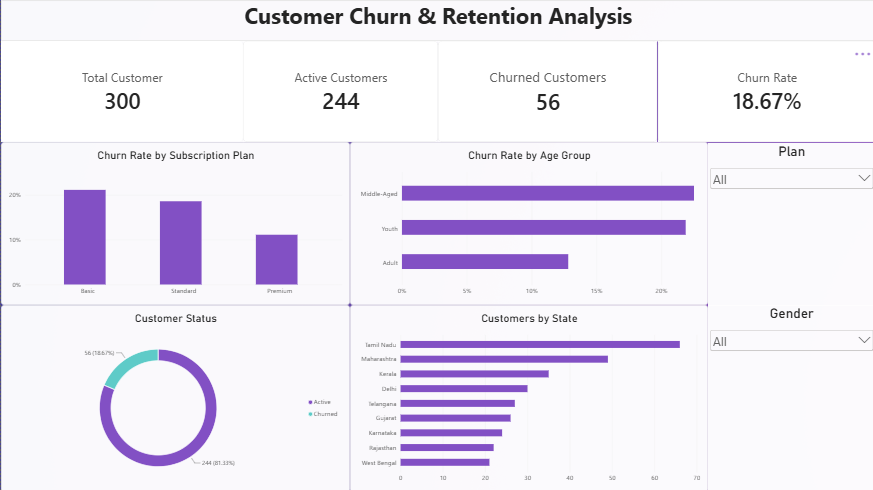

# Customer Churn & Retention Analysis

## 📌 Project Overview

Customer churn is an important business problem for subscription-based companies. Understanding which customers are more likely to churn can help businesses improve retention strategies and reduce revenue loss.

This project analyzes customer churn and retention using **MySQL and Power BI**.

The project follows an end-to-end data analyst workflow:

> Raw Data → MySQL → SQL Analysis → Power BI Dashboard → Business Insights

The analysis focuses on customer behavior, subscription plans, customer segments, tenure, payments, activity, and support interactions to identify patterns associated with customer churn.

---

## 🎯 Business Objectives

The main objectives of this project are to:

- Measure the overall customer churn rate.
- Compare churn across different subscription plans.
- Analyze churn across customer age groups.
- Understand the relationship between customer tenure and churn.
- Compare revenue generated by active and churned customers.
- Analyze churn based on payment methods.
- Understand customer activity levels among active and churned customers.
- Analyze the relationship between support tickets and customer churn.
- Identify customer groups that may require better retention strategies.

---

## 🗂️ Dataset

The project uses a synthetic SaaS subscription dataset containing four related tables.

### 1. Customers

Contains customer demographic and registration information.

| Column | Description |
|---|---|
| `customer_id` | Unique customer identifier |
| `customer_name` | Customer name |
| `gender` | Customer gender |
| `age` | Customer age |
| `city` | Customer city |
| `state` | Customer state |
| `signup_date` | Customer registration date |

### 2. Subscriptions

Contains customer subscription information.

| Column | Description |
|---|---|
| `subscription_id` | Unique subscription identifier |
| `customer_id` | Customer identifier |
| `plan` | Subscription plan |
| `start_date` | Subscription start date |
| `end_date` | Subscription end date |
| `monthly_charge` | Monthly subscription charge |
| `status` | Active or Churned |

### 3. Payments

Contains customer payment transactions.

| Column | Description |
|---|---|
| `payment_id` | Unique payment identifier |
| `customer_id` | Customer identifier |
| `payment_date` | Payment date |
| `amount` | Payment amount |
| `payment_method` | Payment method |
| `payment_status` | Paid or Failed |

### 4. Customer Activity

Contains customer activity and support interaction data.

| Column | Description |
|---|---|
| `activity_id` | Unique activity identifier |
| `customer_id` | Customer identifier |
| `activity_date` | Activity date |
| `login_count` | Number of logins |
| `support_tickets` | Number of support tickets |

### Dataset Size

- **300 customers**
- **300 subscriptions**
- **2,684 payment records**
- **1,500 customer activity records**
- **4,784 total records**

---

## 🛠️ Tools & Technologies

- **MySQL** — Data analysis and business queries
- **Power BI** — Data visualization and dashboard
- **SQL** — Aggregation, joins, conditional logic, CTEs and business analysis

---

## 📊 SQL Analysis

The SQL analysis answers eight business questions.

### 1. Overall Customer Performance

Analyzed:

- Total Customers
- Active Customers
- Churned Customers
- Overall Churn Rate

### 2. Churn by Subscription Plan

Compared customer churn across:

- Basic
- Standard
- Premium

### 3. Churn by Age Segment

Customers were grouped into:

- Youth
- Adult
- Middle-aged
- Senior

and churn rates were compared across the groups.

### 4. Churn by Tenure

Customers were grouped based on subscription tenure:

- 0–6 Months
- 7–12 Months
- 13–24 Months
- 25+ Months

### 5. Revenue: Active vs Churned Customers

Compared:

- Number of customers
- Revenue
- Average revenue per customer

between active and churned customers.

### 6. Churn by Payment Method

Analyzed churn rates across different payment methods.

### 7. Customer Activity vs Churn

Compared:

- Average login activity
- Average support tickets

between active and churned customers.

### 8. Support Tickets vs Churn

Customers were grouped based on their total support tickets:

- 0 Tickets
- 1–2 Tickets
- 3–5 Tickets
- 6+ Tickets

and churn rates were compared.

---

## 📈 Power BI Dashboard

The SQL analysis was transformed into an interactive Power BI dashboard.

### Dashboard Features

#### KPI Cards

- Total Customers
- Active Customers
- Churned Customers
- Churn Rate

#### Visualizations

- Churn Rate by Subscription Plan
- Churn Rate by Age Group
- Customer Status
- Customers by State

#### Interactive Filters

- Subscription Plan
- Gender

### Dashboard Preview



---

## 🔍 Key Business Insights

The analysis identified several important customer churn patterns.

### Overall Churn

The dataset contains **300 customers**, of which:

- **244 are active**
- **56 have churned**
- **18.67% is the overall churn rate**

This indicates that customer retention is an important area for the business to focus on.

### Subscription Plan

Churn rates vary across subscription plans, helping identify plans where customers may require stronger engagement and retention strategies.

### Customer Segments

Churn also varies across different age groups, providing an opportunity to target retention strategies toward higher-risk customer segments.

### Customer Activity

Comparing login activity and support interactions between active and churned customers helps identify behavioral patterns associated with churn.

### Payment Behavior

Churn rates across payment methods can help identify whether certain payment channels are associated with higher customer churn.

---

## 💡 Business Recommendations

Based on the analysis, the company could:

- Prioritize retention efforts for higher-churn subscription plans.
- Develop targeted engagement strategies for higher-risk customer segments.
- Monitor customer activity levels to identify customers showing reduced engagement.
- Investigate payment methods associated with higher churn.
- Use customer and geographic information to create targeted retention campaigns.

---

## 📁 Project Structure

```text
Customer-Churn-Retention-Analysis/
│
├── README.md
├── analysis.sql
│
├── data/
│   ├── customers.csv
│   ├── subscriptions.csv
│   ├── payments.csv
│   └── customer_activity.csv
│
├── database/
│   ├── schema.sql
│   └── insert_data.sql
│
└── powerbi/
    ├── Churn_Analysis/
    └── dashboard.png